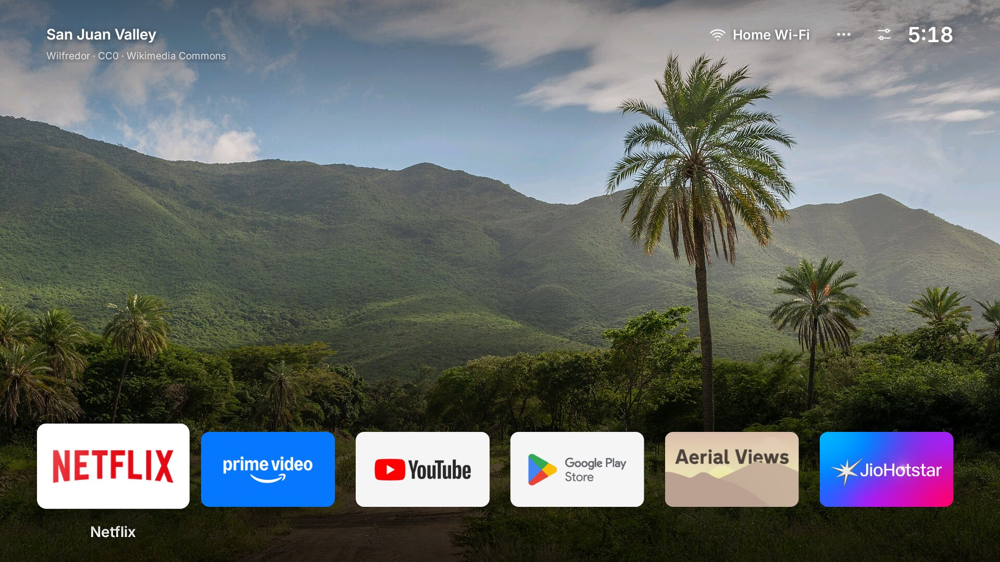
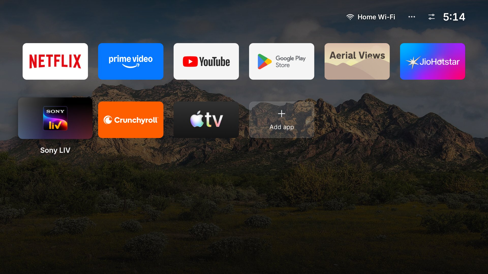

<div align="center">

# Overlook

### An Apple TV-style home screen for Android TV.

A new landscape photo every day, your apps in one clean row, and nothing else.



</div>

Overlook is built on [TV Detox](https://github.com/Ansub/tv-detox) by Ansub Khan. TV Detox cleans the
junk off an Android TV and swaps its home screen for a tiny, calm one. Overlook keeps all of that and
gives the home screen an Apple TV look.

## What you get

- **A new photo every day.** The background is a landscape from Wikimedia Commons' featured pictures:
  mountains, lakes, coasts, sunsets and more. That's about 800 photos, so over two years before one
  comes round again.
- **Matches the time of day** (the default): calm lakes and mountains in the morning, landscapes by
  day, sunsets in the evening. Or pick **Mix**, one collection (just mountains, just beaches…),
  **Favourites**, or **My photos**.
- **Next wallpaper and favourites.** Don't like the photo? **•••** → **Next wallpaper**; the whole
  schedule moves up one, so you won't see it again soon. Love it? **Add to favourites**.
- **Your own photos.** Copy them to the TV and pick **My photos** (they also join the Mix):
  `adb push ~/Pictures/tv/. /sdcard/Android/data/com.ansub.tvhome/files/photos/`
- **Dims at night**, from 10 pm to 6 am, so it isn't bright in a dark room.
- **Works offline.** The photo is downloaded once and kept, so with no internet you still see the
  last one. Before the first photo ever arrives, soft colours slowly drift and change instead.
- **One row of apps.** Only your top six apps sit on the photo. Press **Down** and the rest slide up
  while the photo darkens, so they're easy to read.
- **Wi-Fi, options, Settings, the weather and the clock** at the top right, and a greeting ("Hi
  Suhaas") at the top left. The Wi-Fi shows the network's name; the date and a 24-hour clock are a
  switch away in **•••**. Press **Up** from your apps to reach them.
- **Source** on TVs with inputs: HDMI, AV and the antenna or cable, from the top right (or the remote's
  input button). A connected device shows by name when it reports one over HDMI-CEC ("HDMI 1 ·
  PlayStation 5"), or just as "connected" when it doesn't; names you gave the inputs in TV Settings
  show up too.
- **Folders.** Hold OK on an app → **Add to folder**. The folder's tile shows its apps; OK opens it.
- **Most used first**, if you like: the row sorts itself by what you actually open.
- **A glow in each app's colour** behind the one you're on.
- **Light on old TVs.** It uses about 22 MB of memory on a 1 GB Mi TV Stick, against 79 MB for
  Google's home screen. The drifting colours run at a low frame rate and pause whenever an app is open.



## Install

You need a laptop with `adb` (on a Mac, `brew install android-platform-tools`), and the TV and laptop
on the same network.

**1. Turn on developer mode on the TV.**
Settings → Device Preferences → About → press **Build** 7 times. Then turn on **USB debugging** in
**Developer options**. The first time your laptop connects, the TV asks "Allow debugging?". Tick
"Always allow" and press **Allow**.

**2. Build the app.** There's no download yet, so build it yourself. You need Java 17 or newer, plus
the Android SDK with `platforms;android-34` and `build-tools` 34 or newer.

```sh
sh build.sh
```

The first build makes a signing key, `key.jks`. **Keep it safe.** Updates must be signed with the
same key, or the old app has to be removed first, and that resets your app order. It's left out of
git on purpose.

**3. Install it.**

```sh
sh install.sh <TV_IP>                                          # your apps from apps.txt
sh install.sh <TV_IP> "com.netflix.ninja,com.google.android.youtube.tv"   # or choose them
```

Most TVs keep opening their own home screen, so the script offers to turn that one off. Nothing is
uninstalled. It also lets Overlook read the Wi-Fi network's name. If you already have TV Detox
installed, it's replaced, because the two are signed with different keys.

## Using it

| On the remote | What happens |
|---|---|
| Arrows | Move between apps. Down shows the rest of your apps. |
| Up from the top row | Reach Wi-Fi, •••, and Settings |
| OK on ••• | Options: next wallpaper, favourites, which photos, night dimming, weather, clock, date, app order, and Bluetooth / Sound / Picture settings. Switches flip in place; Back closes it. |
| Hold OK on an app (or press Menu) | Move, replace, add to a folder, remove it, or uninstall apps you installed |
| OK on a folder | Its apps. Hold OK on one to take it out. Hold OK on the folder itself to move, rename or remove it. |
| OK on Source (TVs only) | Pick HDMI 1–3, AV or TV |
| **Add app** tile | Add any installed app |

Settings shortcuts can join the top right too:

```sh
sh install.sh <TV_IP> "" "bluetooth,sound,picture"   # any of them, in any order
sh install.sh <TV_IP> "" "none"                      # take them away
```

## PatchWall info overlay on Mi TV

On the verified MiTV-AXSO0, PatchWall can show the time and weather over the current app: a
full-screen translucent grey layer with a floating clock and weather at the top right, sliding
in from the right. It closes on another press or after eight seconds. After
installing the APK, opt in with `sh overlay.sh <TV_IP> on`. This needs a one-time ADB log permission
and the Overlook accessibility service. See [the Mi TV setup](devices/mi-tv.md#patchwall-time-and-weather-overlay-23-october-2026).

## Make it yours

- **Each TV's setup:** a settings file in `devices/`, like [`mi-tv-stick.conf`](devices/mi-tv-stick.conf):
  the app row, folders, the greeting's name, and the ••• options. `sh install.sh <TV_IP> devices/<tv>.conf`.
- **Default apps:** `apps.txt`, one package name per line, in order.
- **Photo collections:** `COLLECTIONS` in [`Wallpaper.java`](src/com/ansub/tvhome/Wallpaper.java).
  Each name is a Wikimedia Commons category, `Featured pictures of <name>`.
- **The look:** it's plain Java with no libraries, in
  [`MainActivity.java`](src/com/ansub/tvhome/MainActivity.java). The layout is drawn for 1920×1080
  and scaled to the TV. The design it was built from is in [`docs/mockup`](docs/mockup/index.html):
  open it in a browser and use the arrow keys.

After a change, `sh build.sh` and then `adb install -r out/tvhome.apk`.

## Good to know

- **Network name:** Android 9 shows it once Overlook has location access, which `install.sh` grants.
  Android 10 and newer ask for more than that, so there it just says "Wi-Fi".
- **Weather:** from [Open-Meteo](https://open-meteo.com), every 30 minutes. Where the TV is comes from
  its internet address via [ipwho.is](https://ipwho.is), once a week, unless a TV's settings file gives
  `location=<lat>,<lon>`.
- **Most used first** needs usage access, which `install.sh` grants. Without it the order stays yours.
- **Animations:** movement keeps its designed speed whatever animation speed the TV is set to.
  Turning animations off in Developer options still turns them off.
- **Photos:** once a day, about a dozen small requests to Wikimedia's API to pick the photo, then one
  download, usually under 1 MB. Every photo is freely licensed; its photographer and licence are on its
  Commons page.
- **Tested on** a Mi TV Stick and a Mi TV (both Android TV 9, 1 GB RAM). The parts that come from TV Detox, like the
  scripts and turning off the TV's own home screen, are tested on more TVs there.

## Clean up the TV too

The home screen is only half of it. Turning off the bloat is what makes an old TV fast:

```sh
sh candidates.sh <TV_IP>   # lists every app with a verdict, changes nothing
```

[docs/debloat.md](docs/debloat.md) explains the verdicts and which apps never to turn off. TV Detox's
[README](https://github.com/Ansub/tv-detox#readme) has a prompt that lets Claude Code or Codex walk
you through it, asking before every change.

Each TV set up so far is written down in [devices/](devices/README.md): what was turned off and why,
the settings, how to undo it, and a change list `check.sh` can check. That folder also has the
step-by-step for setting up the next TV.

## Undo

```sh
sh undo.sh <TV_IP>
```

This turns your TV's own home screen back on and removes Overlook. After a system update, check
nothing came back:

```sh
sh check.sh <TV_IP>                                  # is Overlook still in charge?
sh check.sh <TV_IP> --fix                            # and fix it
sh check.sh <TV_IP> --fix devices/mi-tv-stick.txt    # plus everything on that TV's list
```

If the TV is stuck restarting, see [TV Detox's help](https://github.com/Ansub/tv-detox#help).

## Credits

- [TV Detox](https://github.com/Ansub/tv-detox) by Ansub Khan: the home screen this is built on, the
  scripts and the cleanup guide. MIT License.
- [Inter](https://rsms.me/inter/) by Rasmus Andersson: the font, under the SIL Open Font License
  ([assets/fonts/OFL.txt](assets/fonts/OFL.txt)).
- Photos by the contributors to [Wikimedia Commons](https://commons.wikimedia.org/wiki/Commons:Featured_pictures),
  each under its own free licence.

MIT License, see [LICENSE](LICENSE).
